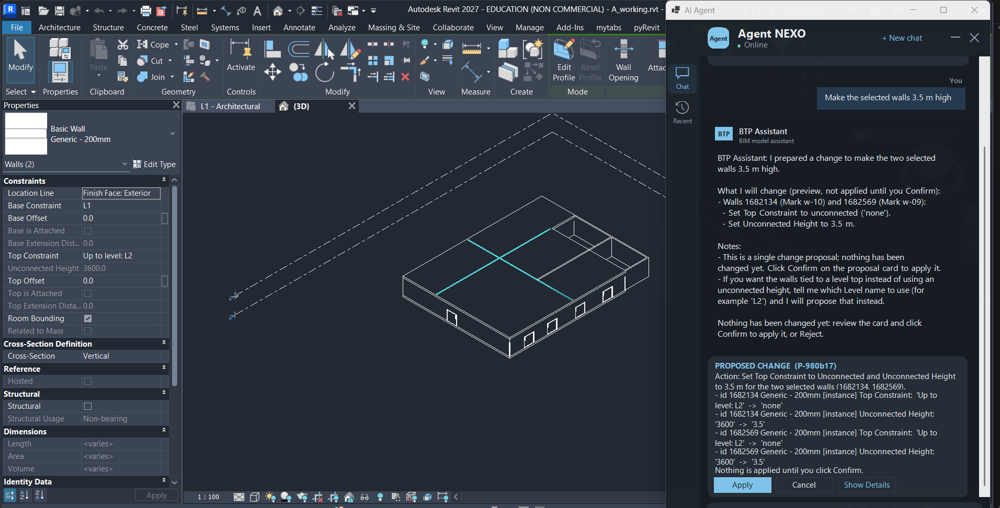
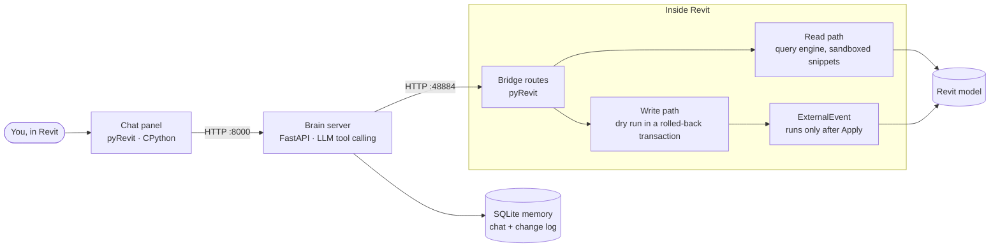

<div align="center">

# Agent NEXO

**Talk to your Revit model. Ask anything, change it safely.**

An AI agent that lives inside Autodesk Revit: plain-language questions get exact answers from the model, and every change is previewed as a dry run and applied only when you click **Apply**.

[](https://github.com/sindhupasham277/BIM_AGENT/actions/workflows/tests.yml)
[](https://github.com/sindhupasham277/BIM_AGENT/releases)
[](LICENSE)


</div>

<!--
  Screenshot: save a capture of the panel as docs/images/panel.png and remove this comment's markers.
  <p align="center"></p>
-->

---

## Contents

[Features](#features) · [How it works](#how-it-works) · [Safety](#safety) · [Requirements](#requirements) · [Installation](#installation) · [Quick start](#quick-start) · [Usage examples](#usage-examples) · [Configuration](#configuration) · [Project structure](#project-structure) · [Testing](#testing) · [Results](#results) · [Roadmap](#roadmap) · [Contributing](#contributing) · [License](#license)

## Features

| | |
|---|---|
| **Ask** | Count, filter and list elements across 25+ categories; read any parameter; areas, lengths, distances; schedules |
| **Check** | Model health report: Revit warnings, clashes between categories, room problems, duplicate marks |
| **Select & view** | Select or highlight elements by condition; temporary isolate, hide and zoom |
| **Change** | Parameters and types; move, copy, rotate, mirror; walls, doors, windows, floors, ceilings, roofs, openings, beams, levels, grids, rooms, curtain grids and mullions, railings, straight stairs |
| **Document** | Schedules (create, edit, place on sheets); plans, sections, 3D views, sheets; tags and text notes |
| **Export** | PDF, DWG, PNG and JPG of views and sheets; IFC of the model |
| **Clean up** | Safe deletion of elements, levels, grids, views, sheets and types, with dependents listed first |

**The panel:** a dark, docked chat window with quick actions, an **Action Preview** card for selections, a **Proposed Change** card (Apply · Cancel · Show Details), **Recent** conversations saved locally, and a launcher chip on the right edge when minimised.

## How it works



1. The **panel** sends your message to the **brain**.
2. The brain's LLM picks tools: read the model, select elements, or **propose an action**.
3. A proposed action runs as a **dry run** in a transaction that is rolled back; the exact old → new values become a card.
4. **Apply** runs the change through an ExternalEvent and checks it against the preview. **Cancel** changes nothing.

Full design: [docs/ARCHITECTURE.md](docs/ARCHITECTURE.md).

## Safety

- **Nothing changes without Apply.** The card shows exactly what will change before anything is kept.
- **Apply must match the preview.** If the model changed in between, the card is refused as stale.
- **Sandboxed code.** Generated snippets cannot import modules, reach private members or loop without bound.
- **Model text is data.** Instructions hidden in model parameters are ignored.
- **Protective refusals.** A level hosting elements, a type in use or the active view cannot be deleted; shortening a wall never cuts off a door.
- **Honest limits.** Unsupported operations are named as unsupported, never faked by delete-and-recreate.
- **One Ctrl+Z** undoes any applied card.

## Requirements

| | Version |
|---|---|
| Autodesk Revit | 2027 |
| pyRevit | 6.5 (CPython engine) |
| Python (brain server) | 3.10 or newer |
| OpenAI API key | model set in [`src/nexo/llm_config.py`](src/nexo/llm_config.py) (default `gpt-5-mini`) |
| OS | Windows 10/11 |

## Installation

```powershell
# 1. Get the code
git clone https://github.com/sindhupasham277/BIM_AGENT.git
cd BIM_AGENT

# 2. Install the brain server's packages
python -m pip install -r requirements.txt

# 3. Install the Revit extension (folder name must stay btp_agent.extension)
Copy-Item -Recurse revit_extension "$env:APPDATA\pyRevit\Extensions\btp_agent.extension"
```

Then restart Revit (or **pyRevit → Reload**). A **BTP** tab appears in the ribbon.

## Quick start

```powershell
# In the BIM_AGENT folder
$env:BTP_API = "<your OpenAI API key>"
python src\nexo\brain_server.py        # serves on http://127.0.0.1:8000
```

Open a model in Revit, click the agent button on the **BTP** tab, and type a question.

## Usage examples

| You ask | The agent |
|---|---|
| *How many doors are on Level 1?* | Answers from the model with the exact count |
| *Which doors have no fire rating?* | Lists them, and offers a card to fill the value |
| *Select all windows wider than 1.2 m* | Shows an Action Preview card; **View in Revit** selects and zooms |
| *Make the selected walls 3.5 m high* | Proposed Change card with every old → new value; nothing changes until **Apply** |
| *Create a schedule of rooms with area and level* | Previews the schedule fields, sorting and filters |
| *Run a model health check* | Warnings, clashes, room problems and duplicate marks, read-only |
| *Export all sheets to PDF* | Card listing the files; written only after **Apply**, never overwriting |
| *Delete Level 4* | Lists what depends on it, and refuses if the level still hosts elements |

## Configuration

| Variable | Required | Purpose |
|---|---|---|
| `BTP_API` | yes | OpenAI API key used by the brain server |
| `BTP_MEMORY_DB` | no | Path of the SQLite memory database. Default: `agent_memory.db` in the repository root |

A template is in [`.env.example`](.env.example). Set the variables in your shell, as above, before starting the brain.

| Setting | Where |
|---|---|
| LLM model | `src/nexo/llm_config.py` |
| Tools offered to the LLM | `src/nexo/tool_schemas.json` |
| Panel colours | `revit_extension/BTP.tab/Agent.panel/chat.pushbutton/theme.json` |
| Ports | brain `8000`, Revit bridge `48884` |

Data kept on your machine: `%AppData%\BTP\recent.json` (conversations, no images), `chip.json` and `window.json` (positions).

## Project structure

```
BIM_AGENT/
├── src/nexo/                  # Brain server (Python 3)
│   ├── brain_server.py        #   FastAPI app: /chat, proposals, LLM tool loop, sessions
│   ├── proposals.py           #   agent rules, proposal building and validation
│   ├── memory.py              #   SQLite memory: turns, tool calls, change log
│   ├── llm_config.py          #   LLM model settings
│   ├── tool_schemas.json      #   tool definitions offered to the LLM
│   └── bim_client.py          #   helper client for the Revit bridge
├── revit_extension/           # pyRevit extension → %AppData%\pyRevit\Extensions\btp_agent.extension
│   ├── startup.py
│   ├── lib/                   #   write facade (revit_rw), action engine, health checks
│   └── BTP.tab/
│       ├── Agent.panel/       #   bridge routes, read path, sandbox, chat panel
│       └── Dev.panel/         #   developer tools
├── tests/                     # Offline and Revit-backed checks
│   └── revit/                 #   scripts that run inside Revit
├── eval/                      # Evaluation harness, test sets, regression suite, results
├── docs/                      # Architecture, API contract, demo script, report, evidence
├── .github/                   # CI workflow, issue and PR templates
├── requirements.txt           # runtime packages
└── requirements-dev.txt       # test and evaluation packages
```

## Testing

| Check | Needs | Command |
|---|---|---|
| Compile all sources | Python | `python -m compileall -q src tests eval` |
| Memory database | Python | `python tests\check_memory.py` |
| Direct regression suite (35 checks, no AI credits) | Revit with a model open | `python eval\direct_regression.py` |
| Model-independent dry-run check | Revit with any model open | `python eval\model_check.py` |

The offline checks run on every push in [GitHub Actions](.github/workflows/tests.yml). AI test sets and their scoring are in `eval/actions/`.

## Results

| Check | Result |
|---|---|
| Full AI test set (plan, catalogue, actions, hard cases) | **136 / 136** at v3.4 and v3.5 |
| Direct regression suite | **35 / 35**, model unchanged after every dry run |
| Large model: Autodesk *Snowdon Towers* (1,241 walls, 18 levels, 279 views) | **18 / 18**, model unchanged |
| Clash check on Snowdon Towers | 102 s → ~26 s (walls × floors, identical 404 pairs) |

Release history: [CHANGELOG.md](CHANGELOG.md). Research phases and evaluation: [`docs/report/`](docs/report/) and [`eval/`](eval/).

## Roadmap

- [ ] Remove machine-specific paths so the extension installs for any Windows user
- [ ] Revit dockable pane instead of an owned window
- [ ] Multi-run stairs with landings, and non-rectangular floor and ceiling sketches
- [ ] Re-sloping existing floors and ceilings
- [ ] Faster first open after Revit starts
- [ ] Wider model coverage beyond the two verified models

### Known limitations

- Several files contain absolute paths for the author's machine (`C:\Users\sindh\…`): the brain's tool audit log, the panel's library path, the bridge routes and a few developer tools. On another machine these need editing until the first roadmap item is done.
- Ramps are not supported (no Revit API for them); existing floors and ceilings cannot be re-sloped.
- NWC export requires the Navisworks exporter add-in.
- The first panel open after Revit starts takes about 2 s.

## Contributing

Contributions are welcome. Read [CONTRIBUTING.md](CONTRIBUTING.md) for the setup, commit style and the one rule every change must keep: no model change without a preview and Apply. Report security issues privately as described in [SECURITY.md](SECURITY.md).

## License

[MIT](LICENSE)
