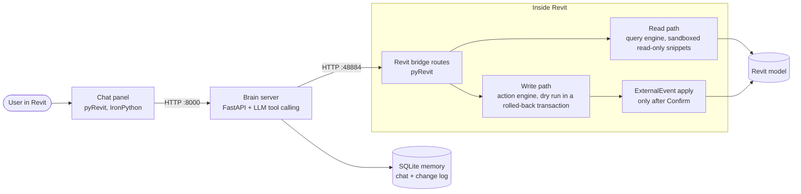

# BTP BIM Agent

**A conversational AI assistant that lives inside Autodesk Revit.** Ask about your model in plain language, get exact answers, and make changes safely: every change is previewed as a dry run and applied only after you confirm it.


---

## Contents

- [What it does](#what-it-does)
- [How it works](#how-it-works)
- [Safety model](#safety-model)
- [Project timeline](#project-timeline)
- [Results](#results)
- [Repository structure](#repository-structure)
- [Getting started](#getting-started)
- [Testing](#testing)
- [Known limitations](#known-limitations)
- [Documentation](#documentation)

---

## What it does

| Area | Capabilities |
|---|---|
| **Ask** | Count, filter and list elements across 25+ categories; read any parameter; areas, lengths, distances; schedules; model health (Revit warnings, clashes, room problems, duplicate marks) |
| **Select & view** | Select or highlight elements by condition; temporary isolate, hide and zoom |
| **Change** | Set parameters; change types; move, copy, rotate, mirror; walls, doors, windows, floors, ceilings, roofs, openings, beams, levels, grids, rooms, curtain grids and mullions, railings, straight stairs |
| **Document** | Schedules (create, edit, place on sheets); plans, sections, 3D views, sheets; tags and text notes |
| **Export** | PDF, DWG, PNG/JPG of views and sheets; IFC of the model |
| **Clean up** | Safe deletion of elements, levels, grids, views, sheets and types, with dependents listed first |

The chat panel offers a quick-action welcome card, an **Action Preview** card for selections, a **Proposed Change** card (Apply / Cancel / Show Details), **Recent** conversations saved on disk, and a minimised launcher chip on the right edge of the screen.

## How it works



1. The **panel** sends your message to the **brain**.
2. The brain's LLM chooses tools: read the model, select elements, or **propose an action**.
3. Proposed actions run as a **dry run** inside a transaction that is rolled back. The exact old → new values become a card.
4. Only when you click **Apply** does Revit execute the change, through an ExternalEvent, and the result is checked against the preview.

See [docs/ARCHITECTURE.md](docs/ARCHITECTURE.md) for the full design.

## Safety model

- **Nothing changes without Confirm.** Every change is previewed first; the card shows exactly what will change.
- **Apply must match the preview.** If the model changed in between, the card is refused as stale.
- **Sandboxed code.** Generated read-only snippets cannot import modules, access private members, or run unbounded loops.
- **Model text is data, never instructions.** Prompt-injection text in the model is ignored.
- **Protective refusals.** Deleting a level that hosts elements, a type in use, or the active view is refused; shortening a wall never cuts off a door.
- **Honest limits.** Unsupported operations are named as unsupported, never faked or emulated by delete-and-recreate.
- **One Ctrl+Z** undoes any applied card.

## Project timeline

| Phase | Dates | Outcome | Tag |
|---|---|---|---|
| **Phases 1-4: Foundations** | 9-30 Sep 2026 | Read-only BIM assistant: query engine, sandboxed code generation, LLM tool calling, evaluation scaffolding | `phase4-done` |
| **Phase 5: Safe write path** | 1-9 Oct 2026 | Fix plans, proposal cards, Confirm/Reject, ExternalEvent apply, stale checks, sandbox firewall, SQLite memory and change log | `phase5-complete` |
| **Phase 6: Evaluation** | 12-17 Oct 2026 | Frozen configuration; query accuracy, audit precision/recall, false-positive and sandbox attack tests | `phase6-complete` |
| **Phase 7: Demo & report** | 17-18 Oct 2026 | Demo script, rehearsals, recorded videos, architecture diagram, report chapters | `phase7-complete` |
| **Action agent M1-M6** | 18 Oct 2026 | Selection, action engine with rolled-back dry run, walls, types, move/copy, deletion, doors/windows | `actions-v1`, `v1.1` |
| **v2: Hardening** | 19 Oct 2026 | Per-request limits, one proposal per message, capability inventory, validator fixes | `actions-v2` |
| **v3.0-3.5: Capability families** | 20-22 Oct 2026 | Rotate/mirror, any family, levels/grids, floors/ceilings, views, joins, documentation; rule hardening (C16-C35) | `actions-v3` … `v3.5` |
| **v3.6-3.13: Documentation & modelling** | 22-23 Oct 2026 | Schedules, views and sheets, model health, rooms, PDF export, openings, beams, roofs, wall length, ceilings, groups | `actions-v3.6` … `v3.13` |
| **v3.14-3.17: Advanced modelling & scale** | 24 Oct 2026 | Multi-format exports, safe deletion, sloped floors/ceilings, curtain walls, railings, stairs; raised limits; large-model verification | `actions-v3.14` … `v3.17` |
| **v3.18-3.23: Panel experience** | 25 Oct 2026 | Redesigned panel, Action Preview card, Recent conversations, Revit-owned window, launcher chip, smooth opening | `actions-v3.18` … `v3.23` |

Full details per release: [CHANGELOG.md](CHANGELOG.md).

## Results

| Check | Result |
|---|---|
| Full AI test set (plan, catalogue, actions, hard cases) | **136 / 136** at v3.4 and v3.5 |
| Direct regression suite (no AI credits) | **35 / 35**, model unchanged after every dry run |
| Large-model check on Autodesk *Snowdon Towers* (1,241 walls, 18 levels, 279 views) | **18 / 18**, model unchanged |
| Clash check speed-up on Snowdon Towers | 95 s → 0.5 s (empty category); 102 s → ~26 s (walls × floors, identical 404 pairs) |
| Phase 6 evaluation | Query accuracy, audit precision/recall and safety results in `eval/` and `docs/report/` |

## Repository structure

```
BIM_AGENT/
├── brain_server.py          # FastAPI brain: chat endpoint, LLM tool loop, sessions, proposals
├── proposals.py             # proposal building, validation and the agent's rules
├── memory.py                # SQLite memory: chat turns, tool calls, change log
├── llm_config.py            # LLM parameters (centralised)
├── tool_schemas.json        # tool definitions offered to the LLM
├── bim_client.py            # client helpers
├── btp_agent_snapshot/      # the pyRevit extension (copied to %AppData%\pyRevit\Extensions)
│   ├── startup.py
│   ├── lib/                 # revit_rw (write facade), write_functions, action_exec, health_checks
│   └── BTP.tab/Agent.panel/ # routes.py (Revit bridge), revit_ro.py, chat.pushbutton (the panel)
├── eval/                    # evaluation harness, test sets, results, regression and model checks
├── tests/                   # Phase 5 safety and dispatch checks
├── sandbox/                 # sandbox tests
├── llm_tools/               # LLM tool-calling tests
└── docs/                    # architecture, API contract, demo script, report, evidence, figures
```

## Getting started

**Requirements:** Autodesk Revit 2027, pyRevit 6.5, Python 3 for the brain server, and an LLM API key configured as described in `llm_config.py`.

1. **Install the extension.** Copy `btp_agent_snapshot` to `%AppData%\pyRevit\Extensions\btp_agent.extension`, then restart Revit.
2. **Start the brain server** (from the repository folder):
   ```powershell
   $env:BTP_MEMORY_DB = "$PWD\eval\results\memory.db"
   python brain_server.py
   ```
3. **Open a model in Revit** and click the assistant button on the **BTP** tab.

## Testing

```powershell
python eval\direct_regression.py   # 35 checks through the Revit bridge, no AI credits
python eval\model_check.py         # model-independent dry-run check for any open model
```

AI test sets and their scoring live in `eval/actions/`.

## Known limitations

- Ramps (no Revit API), multi-run or landing stairs, and non-rectangular sketches are not supported.
- Existing floors and ceilings cannot be re-sloped.
- NWC export requires the Navisworks exporter add-in.
- The panel is a Revit-owned window docked at the right edge, not a Revit dockable pane.
- The first panel open after Revit starts takes about 2 s; later opens are instant.
- Tested on two models (a small test model and Autodesk *Snowdon Towers*).

## Documentation

| Document | Contents |
|---|---|
| [docs/ARCHITECTURE.md](docs/ARCHITECTURE.md) | Components, data flow, safety layers, storage |
| [CHANGELOG.md](CHANGELOG.md) | Every release, newest first |
| [docs/api_contract.md](docs/api_contract.md) | Brain and bridge API contract |
| [docs/demo_script.md](docs/demo_script.md) | Demo script |
| [docs/report/](docs/report/) | Project report chapters |
