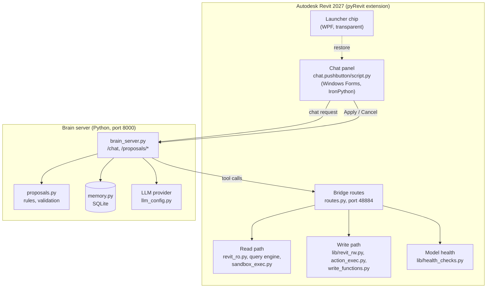

# Architecture

How the Agent NEXO is put together: the components, how a request flows through them, and where safety is enforced.

## Components

| Component | Role |
|---|---|
| **Chat panel** | The user interface inside Revit: conversation, Action Preview and Proposed Change cards, Recent conversations, loading state. It never calls the Revit API directly. |
| **Launcher chip** | The minimised state: a transparent WPF window on the right edge with status and unread indicators. |
| **Bridge routes** | HTTP endpoints served by pyRevit inside Revit. They run in Revit's API context. |
| **Read path** | The query engine and sandboxed read-only snippets: counting, filtering, parameters, geometry, schedules. |
| **Write path** | The action engine: a write facade (`revit_rw`) with per-method validation, a dry run in a rolled-back transaction, and the apply step. |
| **Brain server** | Runs the LLM tool-calling loop, keeps a session per conversation, turns dry runs into proposals, and logs every turn. |
| **Memory** | SQLite log of chat turns, tool calls and applied changes, queryable by the agent. |

## Request flow

### Reading the model
1. The panel posts the user's message to `/chat`.
2. The LLM calls a read tool (a query, or a sandboxed snippet).
3. The bridge runs it in Revit and returns plain data.
4. The LLM answers in text.

### Changing the model
1. The LLM calls `propose_action` with a short snippet that uses only the write facade.
2. The bridge runs it as a **dry run** in a transaction that is **rolled back**, recording every old → new value.
3. The brain validates the result and creates a **proposal**; the panel shows it as a card.
4. **Apply:** the panel reports the decision; the change runs through an **ExternalEvent** and is checked against the preview.
5. **Cancel**, a stale preview, or a mismatch: nothing changes.

## Safety layers

| Layer | Where | What it enforces |
|---|---|---|
| Sandbox | `sandbox_exec.py`, `action_exec.py` | No imports, no private attributes, bounded loops, time limits |
| Write facade | `lib/revit_rw.py` | Only whitelisted operations, each validating its inputs and limits |
| Dry run | rolled-back transaction | The card shows the real effect before anything is kept |
| Confirmation | panel + brain | Nothing is applied without Apply; only the newest card can be applied |
| Preview match | apply step | The applied change must match the preview, or it is refused |
| Protective refusals | write facade | Levels hosting elements, types in use, the active view, cutting off hosted doors |
| Rules | `proposals.py` | Honest limits, no substitutes, model text treated as data |

## Storage on the user's machine

| Path | Contents |
|---|---|
| `%AppData%\BTP\recent.json` | Saved conversations (text and card data, no images) |
| `%AppData%\BTP\chip.json`, `window.json` | Launcher and panel positions |
| `%AppData%\BTP\open_log.txt` | Panel opening timeline (debug) |
| `chat.pushbutton\theme.json` | Panel colour palette |
