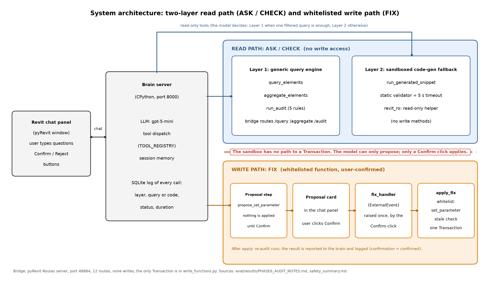

# 2. Architecture

## 2.1 Overview

The agent answers questions about an open Revit model, audits it against five rules, and can change one kind of parameter after the user confirms. It is split into three cooperating parts, because the Revit API can only be called from inside the Revit process, while the LLM client, the memory and the sandbox policy are easier to build and test outside it.

| Part | Where it runs | Role |
|---|---|---|
| Chat panel | pyRevit window inside Revit | Takes the user's text, shows answers and proposal cards, owns the Confirm and Reject buttons |
| Brain server | Separate CPython process, FastAPI on `127.0.0.1:8000` | Calls the LLM (gpt-5-mini) in a tool-calling loop, dispatches tools, keeps session memory, validates parameter names, writes the SQLite log |
| Revit bridge | pyRevit Routes server inside Revit, `127.0.0.1:48884`, 12 routes | The only code with access to the live `Document`: schema, queries, audits, the read-only sandbox, a read-only fix preview, and model info |

The brain talks to the bridge over local HTTP. The panel talks to the brain over local HTTP (`/chat`, `/proposals/{id}/result`, `/proposals/{id}/reject`). The write function itself is not behind HTTP: it is called inside Revit by an `ExternalEvent` handler that the panel raises (section 2.4).

## 2.2 The read path: two layers

The read path serves two kinds of tool, and the LLM decides which to call. Everything on it is read-only.

**Layer 1: the generic query engine.** Two generic tools replace a fixed list of questions. `query_elements` returns the requested fields of the elements in a category that pass a list of filters, and `aggregate_elements` counts, sums, averages or groups them. A schema of the open model (categories and the parameter names that exist, with their data types) is built on the Revit side and supplied to the LLM, so it knows what it may query. Before a query runs, the brain checks that every parameter name matches the schema exactly and refuses the call otherwise. Five audit rules are exposed as a `run_audit` tool (chapter 4). The engine covers the categories Doors, Windows, Walls, Rooms and Columns.

**Layer 2: the sandboxed code-gen fallback.** For questions that one filtered query cannot express (for example, a relationship between two categories), the LLM writes a short Python snippet and sends it with `run_generated_snippet`. The bridge runs it as follows:
1. A static validator parses the snippet and rejects imports, dangerous names and attribute tricks.
2. The snippet runs with a 5 s time limit.
3. It may call only `revit_ro`, a hand-written read-only helper (`get_elements`, `get_param`, `get_geometry_bbox`, `get_host_id`, `get_relationship`, `get_level_of_element`). The helper has no write methods and the generated code never sees the Revit `Document`.

The safety of this layer is the size of the `revit_ro` surface: every method added to it is something generated code can do. Its category map covers Doors, Windows, Walls, Rooms and Levels, which differs from the engine's list (it has no Columns); section 5.2 shows the consequence.

## 2.3 The write path: one whitelisted function

The write path is deliberately narrow, even though the read path is general.

1. The LLM can call exactly one write-related tool, `propose_set_parameter(category, element_ids, param_name, value)`. It applies nothing. It builds a plan with a fresh read of the model, stores the proposal (function, arguments and the expected old values) and returns "NOT applied. The user must click Confirm."
2. The chat panel draws a proposal card showing the change and its scope (for a type parameter: "TYPE-level change: affects 4 elements in total"), with Confirm and Reject buttons.
3. Only the Confirm button's click handler raises the Revit `ExternalEvent`. The handler passes the stored proposal to `write_functions.apply_fix`.
4. `apply_fix` accepts one function name (`set_parameter`), re-plans the change, refuses it if any old value differs from what the proposal recorded ("Model changed since the proposal"), and then runs a single `Transaction` with rollback on error.
5. The result is reported to the brain, which re-runs the relevant audit and writes the outcome to the log. The user sees, for example, "Applied Fire Rating = 60 min (1 target). Re-audit 'missing_fire_rating': 4 -> 0 violations."

`write_functions.py` is the only file that contains a `Transaction`. No generated snippet and no HTTP route reaches it; chapter 6 documents how this was checked and tested.

## 2.4 Why the split

- **Reads are general, writes are narrow.** A wrong read costs a wrong answer; a wrong write corrupts the model. The same flexibility that makes Layer 2 useful for reading would make it dangerous for writing, so writing stays on a named-function whitelist even though it is less flexible.
- **Confirmation is enforced in code, not in the prompt.** The system prompt tells the model to explain that changes go through proposals, but the guarantee comes from the structure: the model has no tool that writes, and the only apply trigger is a button handler.
- **Two processes.** Revit's API is reachable only from Revit's own process, so the bridge runs there, and the LLM client, memory and policy live in a separate CPython process that can be restarted without touching the open model.

## 2.5 Memory and logging

Every tool call and every no-tool chat turn is written to a SQLite table `interactions`. Each row records the model name, the user's text, the kind (`query`, `audit`, `proposal`, `change`, `memory`, `refused` or `chat`), the layer (`generic_engine`, `code_gen`, `write_function`, `memory` or `none`), the tool name, the query or code used, the status, and the duration. A second table `change_items` records each element changed, with its old and new value. A read-only tool, `query_past_changes`, lets the LLM answer questions such as "what did we change last time" from this log (fixed SQL; the caller supplies only filter values). The evaluation in chapter 5 reads the layer, the code and the tool duration from this log.
