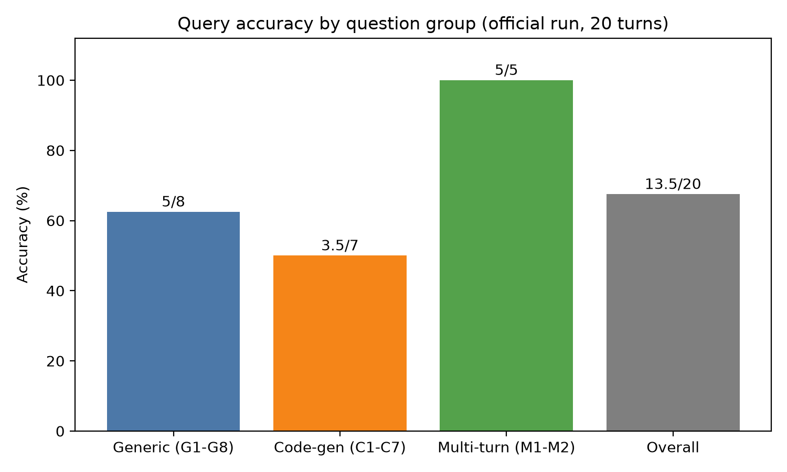
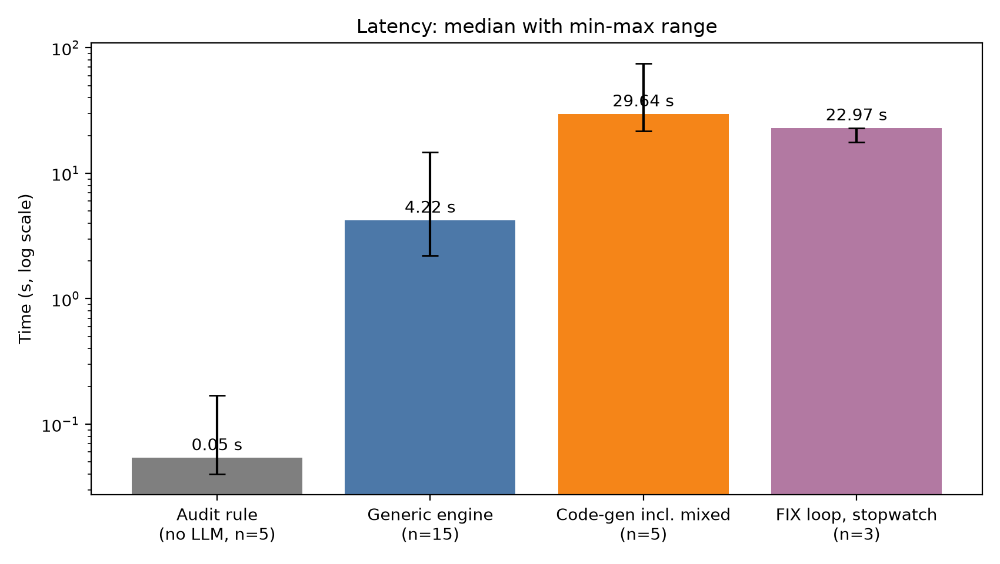
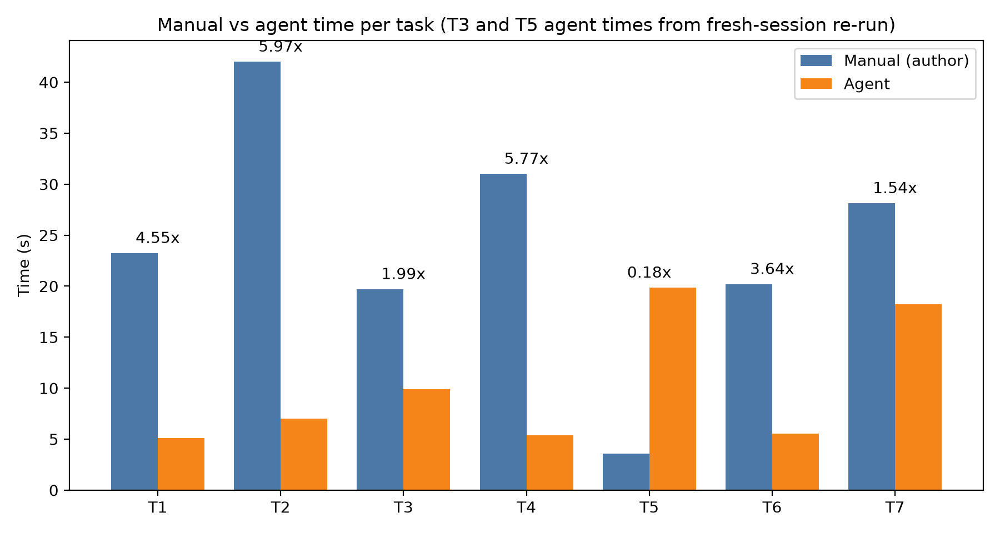

# 5. Evaluation

All numbers in this chapter come from files committed under `eval/` (summary: `eval/results/PHASE6_SUMMARY.md`). Where a number rests on a hand measurement or a self-report, the text says so.

## 5.1 Setup

| Item | Value |
|---|---|
| System under test | Tag `phase5-complete` (commit 051090a) plus one config-only commit (500962a, no behaviour change) |
| LLM | gpt-5-mini, resolved snapshot gpt-5-mini-2025-08-07 |
| Temperature | Model default. The API rejects temperature 0 for this model ("Only the default (1) value is supported"), so runs are not strictly repeatable |
| Platform | Revit 2027, pyRevit 6.5.4, Python 3.14.7, Windows 11, Intel Core i5-1155G7, 16 GB RAM, home Wi-Fi |
| Model A (clean) | 8 doors, 11 walls, 6 structural columns, 8 rooms; SHA-256 BB42705C... |
| Model B (injected) | Copy of A with 16 injected defects (4, 3, 3, 3, 3 across the five audit rules) and 5 decoys; SHA-256 B1C5D6AC... |

The master models were read-only, and every test ran on a working copy reset from its master. The injection manifest was committed before any audit run. An evaluation harness (a separate process, because the system code was frozen) sent each question to the brain server and read the layer, the tool call or code, and the tool duration from the SQLite log. `t_total` is measured by the harness, `t_revit` is the sum of the logged tool durations, and `t_llm = t_total - t_revit`, so `t_llm` also contains brain-server overhead.

## 5.2 Query test (Model A, 20 turns)

**Design.** Eight generic-engine questions (G1-G8), seven geometry or relationship questions intended for the code-gen fallback (C1-C7), and five multi-turn turns (M1: three turns, M2: two turns). Questions and ground truth were committed before the official run. Ground truth came from Revit schedules and plan measurements, never from the agent. The values for C3, C6 and C7 were measured by the author and re-measured once. Scoring: 1 = correct, 0.5 = right quantity with the unit missing or the answer incomplete, 0 = wrong. Routing counts as correct only if the logged layer equals the expected layer exactly.

**Results.**

| Group | Score |
|---|---|
| Generic (G1-G8) | 5.0 / 8 (62.5%) |
| Code-gen (C1-C7) | 3.5 / 7 (50%) |
| Multi-turn (M1-M2) | 5.0 / 5 (100%) |
| **Overall** | **13.5 / 20 (68%)**, 12 fully correct |
| Routing (strict) | 17 / 20 (misses: C1, C4, C5) |

By the layer actually logged: generic engine 12.0 / 15 (n = 15), code-gen only 0.5 / 4 (n = 4), mixed generic + code-gen 1 / 1 (n = 1). The two breakdowns differ because three questions I expected to need code-gen were answered by the generic engine.

**Failure analysis.**

| Question | Score | Cause |
|---|---|---|
| G4, G8 | 0 | The generic engine cannot read a door type name: `Type Name` is null for all 8 doors, and the type is exposed only as an element ID (1680293 on seven doors, 1448341 on one). Grouping returned "Unassigned" and the filter on `d1` matched nothing. |
| G3, G7 | 0.5 | Values correct (661.28 and 82.66), but the unit was stated only as "model units". |
| C2 | 0.5 | The snippet read the element `name` field, which is null for rooms; the `Name` parameter returns "Room 1". The right room was identified by ID. |
| C3, C6, C7 | 0 | The sandbox helper (`revit_ro`) has no Columns entry in its category map, so `get_elements("Columns")` silently returns an empty list. C3 and C6 also indexed bounding-box values as `["min"]["x"]`, but a bounding box is `{"min": [x, y, z], ...}` in feet. |
| C4 | 1 | Matches the ground truth ("no rooms contain a column") but is vacuous: the snippet had no columns to test. |
| C1, C5 | 1 | Correct, but answered by the generic engine, so they count as routing misses. |

**Sensitivity.** Scoring C4 as 0 gives 12.5 / 20 (62.5%) overall and 2.5 / 7 (36%) for code-gen. C4 was kept at 1 because the rubric was fixed before the run. Under the looser reading "code-gen only when needed", C1 and C5 are not routing errors; the strict figure is the one reported.

**Sandbox behaviour.** The static validator rejected unsupported syntax in the generated snippets (AugAssign, UnaryOp, DictComp, GeneratorExp, While, Pow), and the model rewrote the snippet each time (C7 needed four rewrites, C6 three). Each rewrite costs another LLM round trip, which explains much of the code-gen latency in section 5.4.

**Paraphrase check.** A classmate reworded six of the questions (G1, G2, G3, G5, C1, C2). They were collected after the official run, so they form a separate robustness run rather than part of the score. The reworded run scored 5.5 / 6 against 5.0 / 6 for the same six questions in the official run. C2 differed (the room name was returned this time), which shows run-to-run variance.

## 5.3 Audit test (precision and recall)

| Rule | Injected | TP | FP | FN | Precision | Recall |
|---|---|---|---|---|---|---|
| `missing_fire_rating` | 4 | 4 | 0 | 0 | 1.00 | 1.00 |
| `missing_room_name` | 3 | 3 | 0 | 0 | 1.00 | 1.00 |
| `missing_room_number` | 3 | 3 | 0 | 0 | 1.00 | 1.00 |
| `missing_wall_mark` | 3 | 3 | 0 | 0 | 1.00 | 1.00 |
| `missing_column_type_mark` | 3 | 3 | 0 | 0 | 1.00 | 1.00 |
| **Overall** | **16** | **16** | **0** | **0** | **1.00** | **1.00** |

None of the 5 decoys was flagged, and none of the five rules flagged anything on the clean Model A (0 false positives). An audit run takes a median of 0.05 s on Model B (range 0.04-0.17 s) and 0.02 s on Model A.

The score is expected: the injected defects are blank values, which is exactly what the rules test. It shows the rules do what they are defined to do, not that they find other defect types. Whitespace-only values, architectural columns and elements that lack the parameter altogether are not covered. Rules 1 and 5 work through the element type, so one blank type flags every instance on it; the manifest therefore lists instance IDs.

## 5.4 Latency

| Category | n | Median total | Range | Median LLM | Median Revit |
|---|---|---|---|---|---|
| Generic engine | 15 | 4.2 s | 2.2-14.7 s | 4.2 s | 0.04 s |
| Code-gen (incl. one mixed turn) | 5 | 29.6 s | 21.7-75.2 s | 29.4 s | 0.16 s |
| Audit rule (no LLM) | 5 | 0.05 s | 0.04-0.17 s | n/a | n/a |
| FIX loop (stopwatch) | 3 | 23.0 s | 17.8-23.0 s | n/a | n/a |

Almost all of the time is spent in the LLM; Revit execution is under 0.2 s per call. Code-gen is about seven times slower than the generic engine, mainly because rejected snippets are rewritten. The FIX loop was timed by stopwatch (accuracy about 0.5 s): proposal card 19.0 s median (14.0-19.8 s) and Confirm to re-audit message 3.8 s (3.2-4.0 s). The Confirm step has no logged duration, so it is not attributed to Revit or to the LLM. Later demo rehearsals measured 10.0-10.4 s and 5.3-5.5 s for the same two segments; the difference between sessions was not investigated.

## 5.5 Manual versus agent

| Task | Manual | Agent | Speedup | Agent time source |
|---|---|---|---|---|
| T1 Count doors with fire rating 2H | 23.2 s | 5.1 s | 4.55x | hand-recorded, 2 trials |
| T2 Total area of all rooms | 42.0 s | 7.0 s | 5.97x | hand-recorded, 2 trials |
| T3 Count structural columns | 19.7 s | 9.9 s | 1.99x | harness median of 3 fresh-session runs |
| T4 Count walls longer than 5 m | 31.0 s | 5.4 s | 5.77x | hand-recorded, 2 trials |
| T5 Room with the most doors | 3.6 s | 19.8 s | 0.18x | harness median of 3 fresh-session runs |
| T6 Count doors missing a fire rating | 20.2 s | 5.5 s | 3.64x | hand-recorded, 2 trials |
| T7 Set fire rating to 60 min on missing doors | 28.1 s | 18.2 s | 1.54x | hand-recorded, 2 trials |

The median speedup over the seven tasks is 3.64x, and the agent was slower on one task (T5, about five times slower than a person who knows where the answer is).

The 3.64x figure is indicative, not precise:
- Manual times were taken by the author of the model, who knows where everything is, so they are optimistic. Revit experience: B.Tech Civil Engineering student with academic BIM project experience (duration not recorded).
- The original hand-recorded agent times for T3 and T5 were invalid: the log showed answers reused within one conversation or given without a tool call. They were replaced by harness runs with a fresh session, which exclude typing time. The other five tasks use hand-recorded times; whether the questions were typed or pasted was not recorded.
- Agent correctness for T1, T2, T4, T6 and T7 is self-reported. The log supports T2, T4 and T6; the second T7 agent trial has no matching apply event in either log.
- T3 gave three different behaviours for the same question (a hedged answer, a clean answer, and an answer with no tool call).

## 5.6 Summary of findings

- The two-layer design works as intended on simple questions (generic engine 80% by logged layer) and on multi-turn questions (5 / 5), and the audit rules found all 16 injected defects with no false positives.
- The code-gen fallback is the weak point (0.5 / 4 by logged layer), and the causes are tool limitations, not model reasoning: a sandbox helper without a Columns category, a restrictive syntax validator, and a bounding-box format the model had to guess.
- The agent is faster than manual work on six of seven tasks, but not on a relationship question that the code-gen layer has to solve.
- Limits of this evaluation: a small development model, one run per question, uncontrollable temperature, author-measured ground truth, and an optimistic manual baseline.
